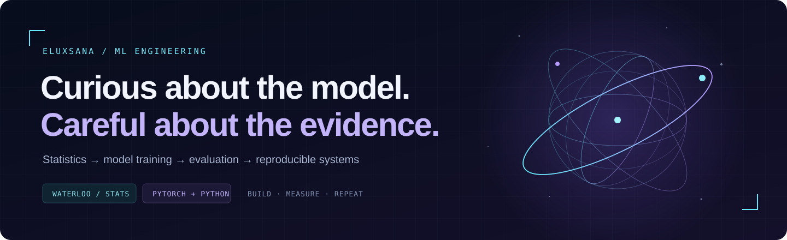

  

  <a href="https://github.com/eluxsana/RunLedger">Explore RunLedger</a> &nbsp; / &nbsp;
  <a href="https://github.com/eluxsana/RunLedger/blob/main/docs/EXPERIMENTS.md">Read the experiments</a> &nbsp; / &nbsp;
  <a href="https://www.linkedin.com/in/eluxsana">Say hello</a>

### Hi, I'm Eluxsana.

I'm a machine learning engineer with a statistics background from Waterloo. I work across model training, evaluation, and the systems around them. I like the part where an experiment turns into something another person can run, inspect, and trust.

Python and PyTorch are my main tools. Spark, Ray, SQL, and Parquet show up when the data or the training job gets bigger.

---

### 01 / RunLedger

**An evaluation worker dies halfway through saving results. What can you still trust?**

That's the question behind my small, CPU-first evaluation project. RunLedger combines versioned datasets, resumable jobs, pinned model configurations, and evidence reports you can inspect. I care about the failure cases as much as the final accuracy number.

- **Break it:** kill a worker at three commit boundaries and check the recovered predictions.
- **Trace it:** follow a result back to its dataset, model revision, and scoring configuration.
- **Measure it:** inspect the 128-question ARC-Easy diagnostic and the raw loading-study results.

[Code](https://github.com/eluxsana/RunLedger) · [Experiments & limitations](https://github.com/eluxsana/RunLedger/blob/main/docs/EXPERIMENTS.md) · [Design decisions](https://github.com/eluxsana/RunLedger/blob/main/docs/ARCHITECTURE.md)

### 02 / Questions I want to work on

What changes between two model versions, beyond the headline score? Which evaluation failures come from the model, and which come from the pipeline? How much infrastructure is enough to make a small experiment reliable?

I'm exploring these through RunLedger and contributions to tools I use. I'll link upstream work here once there's something concrete to read.

---

Older repositories include university and early learning projects. This page is where I keep my current work and the questions behind it.
