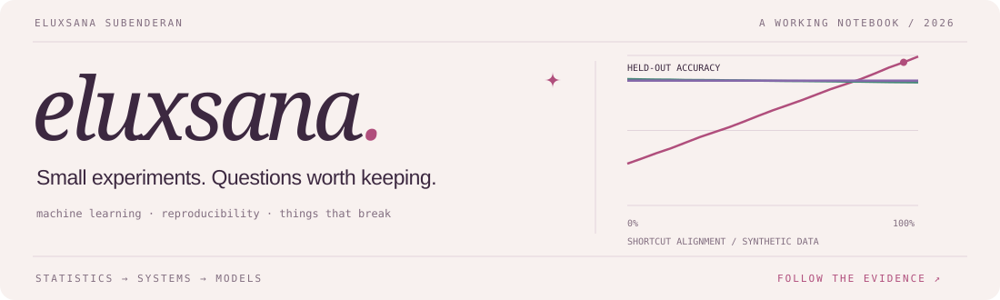

  

  <a href="https://eluxsana.github.io/recall-lab/">Open the lab</a> &nbsp; / &nbsp;
  <a href="https://github.com/eluxsana/RunLedger/blob/main/docs/EXPERIMENTS.md">Read the experiments</a> &nbsp; / &nbsp;
  <a href="https://www.linkedin.com/in/eluxsana">Say hello</a>

### Hi, I'm Eluxsana.

Machine learning engineer. Statistics at Waterloo. I work on training, evaluation, and the systems that connect them.

The questions I keep coming back to are fairly concrete: did the model learn what we hoped it learned? Can someone else reproduce the result? What happens when the job dies halfway through?

Python and PyTorch are my usual starting point. Spark, Ray, SQL, and Parquet come in when the data or the job gets bigger.

### Things I’m building

<table>
<tr>
<td width="50%" valign="top">

#### 01 · Recall Lab

**A tiny transformer, opened up.**

Train from random weights, follow a head's attention, and change the value the model has to retrieve.

69,832 parameters. Three training seeds. Real checkpoints, input interventions, and a longer-context stress test. Synthetic recall, not language understanding.

[Open the attention explorer →](https://eluxsana.github.io/recall-lab/) 
[Code](https://github.com/eluxsana/recall-lab) · [Methods & limits](https://github.com/eluxsana/recall-lab/blob/main/METHODS.md)

</td>
<td width="50%" valign="top">

#### 02 · RunLedger

**A worker dies. Which results survive?**

Versioned datasets and resumable evaluation jobs, tested by killing real worker processes at transaction boundaries.

Pinned model scoring, evidence receipts, a loading study, and a prediction-drift explorer. Local and CPU-first; no cluster-scale claims.

[Open the evidence desk →](https://eluxsana.github.io/RunLedger/) 
[Code](https://github.com/eluxsana/RunLedger) · [Design decisions](https://github.com/eluxsana/RunLedger/blob/main/docs/ARCHITECTURE.md)

</td>
</tr>
</table>

Also in the notebook: **[Shortcut Lab](https://eluxsana.github.io/shortcut-lab/)** — a small, interactive experiment in distribution shift, with three training controls and no Python dependencies.

### A note from the experiments

In Shortcut Lab, **95.4% overall accuracy hides 34.0% on the conflicting group**. Changing the test distribution drops the same model to 31.3%. The little chart above is drawn from those measurements.

The example is intentionally small. I want the assumptions, code, and failure to fit in the same conversation. [What the experiment cannot tell us →](https://github.com/eluxsana/shortcut-lab/blob/main/METHODS.md)

### In the open

[Hugging Face Hub · cache lookup verification](https://github.com/huggingface/huggingface_hub/pull/5243#issuecomment-6401982920)

Tested an existing contributor's fix with extra offline cases for string and Path cache directories, branch refs, and missing-file markers. Shared the results upstream. Verification on an open PR; not a merged code contribution.

A few things I'm exploring next

- How much a result changes across training seeds, not just test examples.
- Which answer flips an aggregate evaluation score hides.
- Small contributions to the tools I actually use, with reproducible cases.

---

Older repositories include university and early learning projects. Current projects document AI assistance, measurements, and limitations alongside the code.
